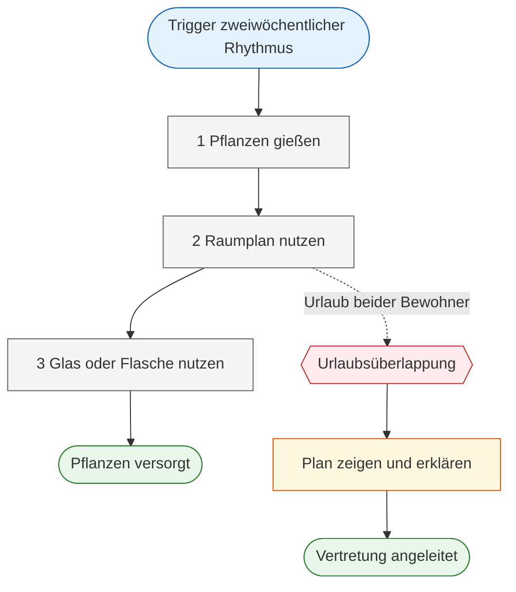
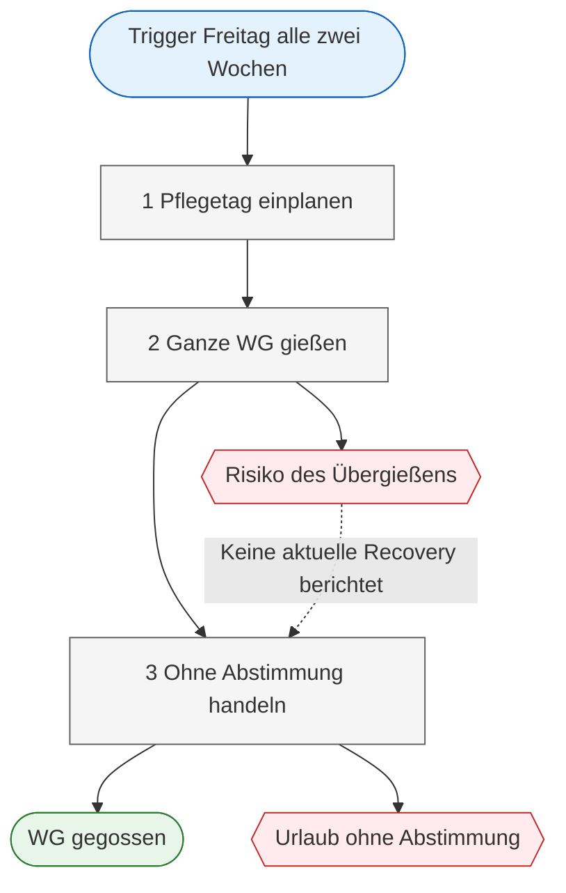

# Sequence Model: Blumify Research — Regelmäßige Pflanzenpflege in einer WG

**Current practice:** Mitbewohnerinnen gießen die Pflanzen der WG in einem zweiwöchentlichen Rhythmus. Die Ausführung unterscheidet sich wesentlich: Johanna orientiert sich an einem raumbezogenen Plan und übergibt diesen bei gemeinsamer Abwesenheit; Anna führt freitags eine WG-weite Pflegerunde ohne Abstimmung durch.

**User role:** WG-Mitbewohnerinnen, die Pflanzen pflegen | **Evidence base:** mh-je, dw-am | **Confidence:** medium

> **Confidence:** Das Modell beruht auf retrospektiven Aussagen aus semi-strukturierten Interviews, nicht auf einer beobachteten Pflegerunde. Ausführungsrhythmen, verwendete Artefakte und beschriebene Koordinationsprobleme sind direkt berichtet; einzelne Übergänge und Entscheidungsregeln bleiben offen.

---

## Model 1: Regelmäßige Pflegerunde nach raumbezogenem Gießplan — Variante Johanna

**Trigger:** Der zweiwöchentliche Gießrhythmus. **[mh-je #14]**  
**Intent / Goal:** Die Pflanzen der WG regelmäßig versorgen und ihre Versorgung bei Abwesenheit ermöglichen.  
**Outcome:** Die Pflanzen werden nach einem raumbezogenen Gießplan gegossen; bei Urlaub beider Bewohner wird der Plan einer Vertretung gezeigt und erklärt. **[mh-je #14]**

### Sequence

| # | Action | Intent | Artifact / Tool | Evidence | Notes |
|---|---|---|---|---|---|
| 1 | Gießt die Pflanzen im zweiwöchentlichen Rhythmus. | Die regelmäßige Versorgung der Pflanzen sicherstellen. | Gießplan | Direct: **[mh-je #14]** | |
| 2 | Orientiert sich an einem nach Räumen gegliederten Gießplan. | Die Pflege für die Räume der WG strukturieren, obwohl die Pflanzenarten nicht bekannt sind. | Raumbezogener Gießplan | Synthese: **[mh-je #14]**, **[mh-je #15]** | Der Plan ist nach Raum, nicht nach Pflanze, organisiert. |
| 3 | Verwendet zum Gießen das gerade verfügbare Glas oder die verfügbare Flasche. | Die Pflanzen unmittelbar gießen, ohne ein festes Spezialwerkzeug zu benötigen. | Glas oder Flasche | Direct: **[mh-je #16]** | |
| 4 | Zeigt und erklärt bei Urlaub beider Bewohner den Plan einer Vertretung und erinnert diese auch ans Lüften. | Die Versorgung während der Abwesenheit übergeben. | Gießplan; mündliche Erklärung | Direct: **[mh-je #14]** | Dieser Schritt gilt nur bei Urlaub beider Bewohner. |

### Breakdowns and Recovery

| At step | Breakdown | Consequence for the work | Recovery / Workaround | Evidence |
|---|---|---|---|---|
| 4 | Unsicherheit bei Urlaubsüberlappung der Mitbewohner. | Es ist unklar, wer die Pflanzenpflege übernimmt; eine Vertretung wird nötig. | Der vorhandene Gießplan wird der Vertretung gezeigt und erklärt. | **[mh-je #5]**, **[mh-je #14]** |
| 2–3 | Die Bewohner wissen nicht, welche Pflanzen sie haben; der Plan ist nicht pflanzenspezifisch. | Pflegeentscheidungen können nicht am Bedarf einzelner Pflanzen ausgerichtet werden. | Orientierung am raumbezogenen Plan. | **[mh-je #15]** |

### Variants and Branches

| Variant | When it applies | Different sequence or decision | Evidence |
|---|---|---|---|
| Pflegeübergabe | Urlaub beider Bewohner | Plan zeigen und erklären; zusätzlich ans Lüften erinnern. | **[mh-je #14]** |

### Assumptions and Open Questions

| # | Assumption or gap | Why it matters | How to validate |
|---|---|---|---|
| A1 | Es ist nicht belegt, ob beim Gießen jede Pflanze im Raum einzeln geprüft oder pauschal gegossen wird. | Es entscheidet, ob der Plan eine Checkliste oder lediglich eine räumliche Erinnerung ist. | Eine reguläre Pflegerunde beobachten und nach der Entscheidungsregel pro Pflanze fragen. |

### Visualization

**Legend:** Blue = trigger, grey = user action, red = breakdown, amber = recovery/workaround, green = outcome.

---

## Model 2: Zweiwöchentliche WG-Pflegerunde ohne Abstimmung — Variante Anna

**Trigger:** Der festgelegte Pflanzenpflegetag alle zwei Wochen, freitags. **[dw-am #9]**  
**Intent / Goal:** Alle Pflanzen in der WG versorgen, damit sie trotz anderer Prioritäten nicht kaputtgehen. **[dw-am #9]**, **[dw-am #17]**  
**Outcome:** Die ganze WG wird gegossen, jedoch ohne vorherige Abstimmung. **[dw-am #9]**

### Sequence

| # | Action | Intent | Artifact / Tool | Evidence | Notes |
|---|---|---|---|---|---|
| 1 | Nimmt sich freitags alle zwei Wochen einen Tag für Pflanzenpflege. | Der Pflege trotz anderer Prioritäten einen festen Platz geben. | Zeitlicher Routineanker | Direct: **[dw-am #9]**, **[dw-am #17]** | |
| 2 | Gießt an diesem Tag die ganze WG. | Alle Pflanzen versorgen. | — | Direct: **[dw-am #9]** | |
| 3 | Führt die Pflegerunde ohne Abstimmung mit den Mitbewohnern durch. | Keine explizite Absicht berichtet; die fehlende Abstimmung ist Teil der heutigen Praxis. | — | Direct: **[dw-am #9]** | Der Grund für die fehlende Abstimmung ist nicht erhoben. |

### Breakdowns and Recovery

| At step | Breakdown | Consequence for the work | Recovery / Workaround | Evidence |
|---|---|---|---|---|
| 2 | Begrenztes Pflegewissen; insbesondere wird Übergießen genannt. | Risiko einer ungeeigneten Bewässerung. | Keine aktuelle Bewältigungsstrategie berichtet. | **[dw-am #13]** |
| 3 | Bei häufigem Unterwegssein oder Urlaub besteht keine Abstimmung in der WG. | Unklare Verantwortlichkeit für die Versorgung während Abwesenheiten. | Keine aktuelle Bewältigungsstrategie berichtet. | **[dw-am #14]** |

### Assumptions and Open Questions

| # | Assumption or gap | Why it matters | How to validate |
|---|---|---|---|
| A2 | Es ist nicht belegt, ob Anna vor, während oder nach der Pflegerunde feststellt, ob andere bereits gegossen haben. | Klärt, ob fehlende Abstimmung tatsächlich zu Doppelgießen oder Auslassungen führt. | Pflegerunde beobachten; nach der letzten Gießhandlung anderer Mitbewohner fragen. |
| A3 | Es ist nicht belegt, wie die Pflanzen während eines Urlaubs konkret versorgt werden. | Der Ablauf endet bei Abwesenheit möglicherweise ohne Ergebnis. | Einen jüngsten Urlaubsfall Schritt für Schritt rekonstruieren lassen. |

### Visualization

**Legend:** Blue = trigger, grey = user action, red = breakdown, green = outcome. Dotted arrows mark an unconfirmed or absent recovery path.

---

## Cross-Model Findings

| Finding | Supporting evidence | Design relevance |
|---|---|---|
| Der zweiwöchentliche Rhythmus strukturiert die Pflanzenpflege in beiden berichteten WGs. | **[mh-je #14]**, **[dw-am #9]** | Eine Unterstützung muss sich an bestehende Routinen anpassen können. |
| Koordination bei Abwesenheit ist unterschiedlich ausgeprägt. | **[mh-je #5]**, **[mh-je #14]**, **[dw-am #14]** | Die bestehende Übergabepraxis und das Fehlen einer solchen Praxis sind getrennte Nutzungskontexte. |

---

## Out of Scope Evidence

> Notes retained as context but not used as steps in this sequence model.

| Evidence | Why it is out of scope |
|---|---|
| **[mh-je #6]** Von der App gewarnt werden beim Übergießen wäre schön | Produktwunsch, keine berichtete heutige Handlung. |
| **[mh-je #18]** Wunsch nach einem shared Account mit Mitbewohnern und Raumkonfiguration | Produktwunsch, keine berichtete heutige Handlung. |
| **[dw-am #24]** Wichtig: Koordination wer gegossen hat | Bedarf beziehungsweise Wunsch, nicht als bestehende Koordinationshandlung beschrieben. |
| **[dw-am #29]** Idee: Information zu Blumen, Digitale Karte der Wohnung wo man sieht, was gegossen werden muss | Produktidee, keine aktuelle Praxis. |
